  

  
  
  

## `0x00` boot

I'm a final-year AI & ML student who co-founded a startup and ended up building every layer it runs on: C firmware on the sensor boards, a Python server on a Raspberry Pi, the browser screen the referee reads, and, on the side, multi-agent LLM systems.

## `0x01` flagship · Tech Kabaddi

Tech Kabaddi is a sensor-based officiating system for kabaddi: pressure mats on the court, firmware that streams every cell, and a review screen that calls the lines. I lead its engineering as CTO of [Vyanika Innovations](https://vyanikatech.com). The source is private.

- **Firmware:** traced false pressure readings to crosstalk from parallel ADC reads and fixed it with sequential row scanning. One codebase configures itself on every node at boot.
- **Server:** NumPy-vectorised packet decoding, a 30 FPS broadcast cap so one slow tablet never holds up the rest, and O(log n) seeks for replay.
- **Browser:** no framework. Binary WebSocket frames are decoded with `DataView` and heatmaps are written pixel by pixel into `ImageData`.
- **Also mine:** the company site (Astro, Lighthouse 100 on desktop) and certificates whose QR codes carry an ECDSA P-256 signature, checked offline at [vyanikatech.com/verify](https://vyanikatech.com/verify).

## `0x02` open source

  
  

  
  

## `0x03` scoreboard

| result | where |
| :-- | :-- |
| 🥇 **1st of 130 teams** | NAIN 2.0 (2025), Govt. of Karnataka: ₹5 Lakh grant and K-Tech NAIN incubation |
| 🥇 **1st prize** | NAIN Innovation Conclave 2026 at IIIT Bangalore, prototype demonstration |
| 🏆 **Winner** | BOLPU, the Dakshina Kannada MP's startup programme; the only student-led team |
| 🚀 **Incubated** | AIC IIT Delhi (Sonipat campus) |
| 🎯 **Top 50 nationwide** | NSRCEL pre-incubation, IIM Bangalore |
| 🏁 **Finalist** | Elevate, Govt. of Karnataka |
| 🧪 **Semi-finalist** | Elevate NxT 2026 (DeepTech), Govt. of Karnataka, from 983 applicants |
| 📜 **Patent filed** | Indian application 202641005974, Integrated Smart Kabaddi Mat System (co-inventor) |

## `0x04` toolbox

| layer | what I use |
| :-- | :-- |
| **silicon** | `C` `C++` `STM32` `Arduino Giga R1` `ESP32` `Raspberry Pi 5` |
| **server** | `Python` `FastAPI` `Node.js` `Express` `WebSockets` `NumPy` |
| **data** | `MySQL` `MongoDB` `SQLite` |
| **browser** | `JavaScript` `TypeScript` `React` `Next.js` `HTML` `CSS` `Astro` `Tailwind CSS` `GSAP` `Canvas 2D` |
| **agents & ML** | `LLM tool calling` `multi-agent systems` `MCP` `PyTorch` |
| **shipping** | `Git` `GitHub Actions` `pytest` `Playwright` `Linux` `systemd` `Figma` `Claude Code` |

  

<!-- Every image above is generated by tools/make_assets.py (python tools/make_assets.py). -->
